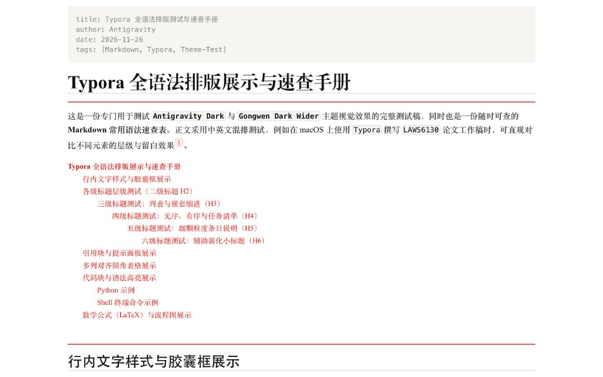
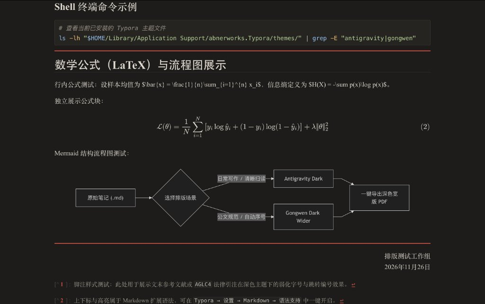

# Annal · 卷帙 — Typora Theme

一套专为**学术写作、长文研究稿与深度阅读**打造的宽屏 Typora 主题，提供亮色（**Annal**）与护眼暖墨暗色（**Annal Dark**）双版本。

A wide-screen academic and editorial theme for Typora, pairing clean GitHub-style Markdown hierarchy with classic Chinese scholarly typography and warm pine-soot ink palettes — in both Light (**Annal**) and Dark (**Annal Dark**) variants.

---

## 核心特色 / Features

* **宽屏舒适字号（Wide & Readable）**：默认 `1200px` 宽版阅读视口 + `20px` 放大基准字号，长文写作不局促、久看不累眼。
* **书卷中英混排字体栈（Scholarly Font Stack）**：
  * 西文与数字统一采用经典的 `Times New Roman`；
  * 中文按语义自然分层：标题采用**小标宋 / 思源宋体**与**黑体**，正文采用温润的**仿宋**，引用与斜体强调自动转为**楷体**（直立不伪斜）。
* **昼夜双生配色（Dual Palettes）**：
  * **Annal（昼 · 白纸朱批）**：温润白纸墨字，搭配经典朱砂红（`#d40000`）分隔线、链接与角标点缀。
  * **Annal Dark（夜 · 松烟暖墨）**：拒绝刺眼纯黑，采用柔和的松烟暖墨底色（`#1d1c1a`）与温润纸墨灰白字（`#ddd8ce`），代码块与流程图均原生适配深色高亮。
* **细节打磨与跨平台兼容**：
  * 修复 macOS 版 Typora 深色主题导出 PDF 时的「四周黑框白底割裂」问题；
  * 修复 Typora 底层样式中文末脚注左右括号颜色不一致问题；
  * **零商用字体打包**：仅通过 CSS `local()` 按优先级调用本机已有字体或自动回退至系统/开源免费字体（macOS / Windows 开箱即用）。

---

## 字体自动匹配表 / Font Fallbacks

| 元素 / Element | 优先调用 / Primary | 系统与开源自动回退 / System & Open-Source Fallbacks |
| :--- | :--- | :--- |
| **西文与数字** | `Times New Roman` | `Times` → `Liberation Serif` → `Tinos` |
| **一级标题 (`H1`)** | 方正小标宋简体 | 思源宋体 (`Source Han Serif SC`) → 宋体-简 (`Songti SC`) → 华文中宋 / 宋体 |
| **二级标题 / 表头 (`H2` / `th`)** | 黑体 (`SimHei` / 中黑) | 思源黑体 (`Source Han Sans SC`) → 苹方 (`PingFang SC`) → 微软雅黑 |
| **三级标题 / 引用 / 斜体 (`H3` / `blockquote` / `em`)** | 楷体 (`KaiTi_GB2312`) | 楷体-简 (`Kaiti SC`) → 华文楷体 → 霞鹜文楷 (`LXGW WenKai`) |
| **正文 (`Body`)** | 仿宋 (`FangSong_GB2312`) | 华文仿宋 (`STFangsong`) → 朱雀仿宋 (`Zhuque Fangsong`) |
| **代码 (`Code`)** | `JetBrains Mono` | `SF Mono` → `Menlo` → `Consolas` |

---

## 安装方法 / Installation

1. 下载本仓库中的 `annal.css` 与 `annal-dark.css`。
2. 打开 Typora → 进入 **设置 / 偏好设置（Preferences）** → **外观（Appearance）** → 点击 **「打开主题文件夹（Open Theme Folder）」**。
3. 将 `annal.css` 和 `annal-dark.css` 复制到打开的 `themes` 目录中。
4. 重启 Typora，在顶部菜单栏 **「主题（Themes）」** 中选择 **`Annal`** 或 **`Annal Dark`** 即可（字母 `An` 开头会自动置顶在菜单前排，切换极快）。

### 推荐搭配设置 / Pro Tips

* **跟随系统日夜自动切换**：在 `Typora 设置 → 外观` 中勾选 **「使用独立的深色主题（Use separate theme in dark mode）」**，将浅色主题设为 `Annal`、深色主题设为 `Annal Dark`。
* **黑底写作 + 白底导出 PDF**：平时使用 `Annal Dark` 护眼撰稿；若需提交白纸黑字标准 PDF，可在 `Typora 设置 → 导出 → PDF → 主题` 中将导出主题指定为 `Annal`。

---

## 致谢与许可 / Credits & License

* 布局骨架基于 Typora 官方内置 `GitHub` 主题扩展重制；
* 东方纸墨色板与中文字体回退栈灵感源自 [MochiaoChen/typora-theme-gongwen](https://github.com/MochiaoChen/typora-theme-gongwen)（MIT License），特此致谢。
* 本项目基于 [MIT License](LICENSE) 开源发布。
